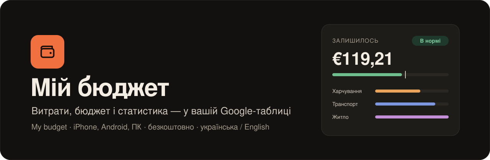

  

  <a href="https://zelinskiy258-lgtm.github.io/budget/"><b>Відкрити програму</b></a>
  &nbsp;·&nbsp;
  <a href="https://zelinskiy258-lgtm.github.io/budget/privacy.html">Конфіденційність</a>
  &nbsp;·&nbsp;
  <a href="#english">English</a>

**Мій бюджет** — безкоштовна програма для щоденного обліку витрат. Ви входите через Google, і програма створює у вашому Google Диску власну таблицю. Усі записи зберігаються лише там: окремого сервера чи бази даних немає.

## Що вміє

- **Ліміт на кожен день.** Скільки лишилось і скільки можна витрачати щодня, щоб укластися в бюджет.
- **Швидке додавання.** Сума, валюта (€, ₴, $), категорія й місце — за кілька дотиків. Додавання, зміну й видалення можна скасувати.
- **Календар місяця.** Зелений день — у межах ліміту, червоний — понад.
- **Статистика.** Місяць, 3 місяці, рік або весь час: динаміка, категорії, дні тижня, улюблені місця, найбільші покупки.
- **Щомісячні платежі.** Оренда, телефон, підписки резервуються в бюджеті й записуються самі у свій день.
- **Закриття місяця.** 1-го числа підсумок переноситься в архів, дашборд перемикається на новий місяць, а на пошту приходить лист.
- **Скарбничка.** Зекономлене можна переносити в наступний місяць або відкладати.
- **Працює без інтернету.** Витрата зберігається на пристрої й надсилається в таблицю, щойно зʼявиться звʼязок.
- **Дві мови.** Українська та англійська. Листи приходять тією ж мовою.

## Як встановити на телефон

1. Відкрийте **[zelinskiy258-lgtm.github.io/budget](https://zelinskiy258-lgtm.github.io/budget/)** і увійдіть через Google.
2. **iPhone:** Safari → «Поділитися» → «На початковий екран».
   **Android:** Chrome → ⋮ → «Додати на головний екран».
   **ПК:** Chrome чи Edge → іконка встановлення в адресному рядку.

Програма відкривається на весь екран, як звичайний застосунок.

## Ваші дані

- Таблиця належить вам і лежить у вашому Google Диску. Її можна відкрити, змінити чи видалити будь-коли.
- Програма працює від вашого імені, з вашим входом Google. Чужі таблиці їй недоступні.
- Паролів, реклами й аналітики немає. Докладно — у [політиці конфіденційності](https://zelinskiy258-lgtm.github.io/budget/privacy.html).

Поки Google не перевірив програму, під час першого входу може зʼявитися попередження. Щоб продовжити, натисніть «Додатково» → «Перейти».

## Як це влаштовано

| Частина | Де | Що робить |
| --- | --- | --- |
| Інтерфейс | цей репозиторій, GitHub Pages | `index.html` — уся програма; `sw.js` — робота без інтернету; `manifest.webmanifest` — встановлення на телефон |
| Сервер | окремий проєкт Google Apps Script | читає й пише вашу таблицю через Apps Script API від вашого імені |
| Дані | Google Таблиця користувача | аркуші «Транзакції», «Дашборд та Бюджет», «Архів», «Підсумки місяців» |

`config.js` містить лише публічні ідентифікатори (OAuth Client ID і ID введення в дію). Секретів у репозиторії немає.

---

## English

**My budget** is a free daily expense tracker. Sign in with Google and the app creates your own sheet in your Google Drive. Every entry is stored only there: there is no separate server or database.

- **A limit for every day:** how much is left and how much you can spend per day to stay within budget.
- **Quick entry** in €, ₴ or $, with undo for adding, editing and deleting.
- **Statistics** for a month, 3 months, a year or all time.
- **Monthly payments** (rent, phone, subscriptions) are reserved and recorded automatically.
- **Month closing** on the 1st: the summary goes to the archive and you get an email.
- **Works offline:** expenses sync once you are back online.
- **Ukrainian and English:** emails come in the same language as the app.

**Install:** open **[zelinskiy258-lgtm.github.io/budget](https://zelinskiy258-lgtm.github.io/budget/)**, sign in, then add it to your home screen (Safari → Share → Add to Home Screen, or Chrome → ⋮ → Add to Home screen).

**Your data:** the sheet is yours, in your Google Drive. The app acts with your own Google sign-in and cannot see anyone else's files. No passwords, ads or analytics. See the [privacy policy](https://zelinskiy258-lgtm.github.io/budget/privacy.html).
